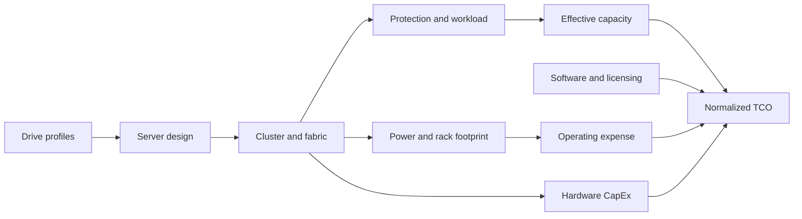

<p align="center">
  <picture>
    <source media="(prefers-color-scheme: dark)" srcset="./apps/web/public/snia-logo-dark.svg">
    
  </picture>
</p>

<h1 align="center">Storage TCO Lab</h1>

<p align="center">
  A transparent, interactive model for designing storage infrastructure and understanding its full-term economics.
</p>

<p align="center">
  <code>Rev 1 candidate</code> · <code>React 19</code> · <code>TypeScript</code> · <code>Vite</code> · <code>shadcn/ui</code> · <code>Tailwind CSS</code>
</p>

<p align="center">
  <a href="https://snia-tco-rev3.pages.dev/"><strong>Launch the live model →</strong></a>
</p>

## Overview

Storage TCO Lab turns drive, server, cluster, protection, software, and operating assumptions into a single auditable total cost of ownership model. It is based on the structure of the SNIA Storage TCO 2.0 model and extends it with modern NVMe, 800G fabric, colocation, licensing, data-reduction, and durability controls.

The application is designed for fast scenario work: nearly every numeric assumption is a slider, derived values update immediately, configurations persist in the browser, and the final cost ledger can be exported to CSV.

This model makes the capacity journey explicit:

```text
Raw TB → Protected TB → Data-reduced TBe → Utilized TBe
```

`Utilized TBe` is the effective capacity remaining after data protection, data reduction, and the configured utilization target. It is the denominator used for normalized TCO.

## What the model covers

| Area                 | What you can model                                                                                                                                    |
| -------------------- | ----------------------------------------------------------------------------------------------------------------------------------------------------- |
| Drive config         | Reusable NVMe SSD and Hard Drive (HDD) library, media presets (TLC, QLC, SATA/SAS Nearline, HAMR, Dual-Actuator), $/TB, power, and AFR               |
| Server config        | Up to 108 bays per server, mixed NVMe + HDD media, sockets, cores, DRAM, rack units, base power, NIC count, ports, link speed, and chassis cost       |
| Cluster config       | Server count, rack density, host network overhead, 32/64-port 400G/800G switches, breakouts, Optics/AOC/DAC presets, switch power, and fabric cost    |
| Software & license   | Upfront raw-TB and per-server licenses plus recurring per-core and per-raw-TB subscriptions                                                           |
| Workload & reduction | Deployment term, mirror, RAID 5, RAID 6, flexible erasure coding, drive/node failure domains, up to 240h rebuild, fleet durability, and reduction     |
| OpEx & NPV config    | PUE-adjusted electricity, peak-power colocation, Internet per rack, administration, hardware support, replacement labor, WACC discount rate, salvage  |
| TCO summary          | Full-term & NPV TCO, per-TBe-month economics, annual cash-flow timeline, side-by-side scenario comparison, shareable links, and CSV / JSON export     |

## Rev 1 baseline

The reset action returns the model to this opinionated five-year reference scenario:

| Assumption      | Default                                                                                   |
| --------------- | ----------------------------------------------------------------------------------------- |
| Drive           | 15.36 TB NVMe, $350/raw TB, 3 W idle, 15 W active, 0.44% AFR                              |
| Storage server  | 24 drives, 1 × 64-core socket, 512 GB DRAM, 2 RU, 650 W base power, $35,000 chassis       |
| Host network    | 2 NICs, 2 ports per NIC, 200 Gb/s per port                                                |
| Cluster         | 12 servers, 42 RU racks, 90 W network overhead per server                                 |
| Fabric          | 2 × 64-port 800G switches, $781.25/port ($50,000/switch), 2,500 W and 2 RU per switch     |
| Optics          | $400 per host optic and $800 per switch-side optic, with 800G breakout accounting         |
| Protection      | RAID 6, 8 data + 2 parity, 24-hour rebuild                                                |
| Capacity        | 90% utilization and 1.5× data reduction                                                   |
| Activity        | 20% active drive duty cycle                                                               |
| Software        | $3 per raw TB per month recurring subscription                                            |
| Electricity     | $0.24/kWh at 1.3 PUE                                                                      |
| Colocation      | $135 per provisioned peak kW per month                                                    |
| Internet        | 100 Gb/s per rack at $100/Gb/s/month                                                      |
| Operations      | $12,000/year administration, 3% annual hardware support, $100 replacement labor per drive |
| Deployment term | 5 years                                                                                   |

Defaults are starting points, not market quotes. Every scenario should be adjusted to match the intended deployment, commercial terms, and facility.

## Calculation flow



At a high level:

```text
Protection factor = (data shards + parity shards) / data shards

Utilized TBe = (raw TB / protection factor)
               × data-reduction ratio
               × utilization

Total TCO = hardware CapEx + software + operating expense

TCO per TBe per month = total TCO / utilized TBe / deployment months
```

Software charged by capacity is intentionally calculated on installed **raw TB**, while normalized outcomes use **utilized TBe**. Colocation is calculated from peak provisioned IT power. Electricity uses average IT load, PUE, time, and the electricity rate. Internet bandwidth is charged once per calculated rack.

The complete formulas, cost-category mapping, network breakout rules, and durability assumptions are documented in [Model overview](./docs/MODEL.md).

## Durability estimate

Mirror, RAID, and erasure-code configurations show an annual durability estimate for one protection set. The implementation uses a binomial rebuild-window model: data loss occurs when failures during a rebuild window exceed the available redundancy.

This is a comparative planning signal, not a durability guarantee. The current model assumes independent failures and does not yet account for correlated failures, failure domains, latent sector errors, rebuild contention, or vendor-specific behavior.

## Getting started

### Prerequisites

- [Bun](https://bun.sh/) 1.3 or newer
- Node.js 20 or newer

### Run locally

```bash
git clone https://github.com/jmhands/snia-tco-rev3.git
cd snia-tco-rev3
bun install
bun run dev
```

Open the local URL printed by Vite. It is normally [http://localhost:5173](http://localhost:5173); Vite will choose another free port if that one is occupied.

### Production check

```bash
bun run typecheck
bun run lint
bun run build
```

The production bundle is written to `apps/web/dist`.

### Deploy to Cloudflare Pages

After authenticating Wrangler with `bunx wrangler@latest login`, publish the current production bundle with:

```bash
bun run build
bunx wrangler@latest pages deploy apps/web/dist \
  --project-name snia-tco-rev3 \
  --branch main
```

The production site is available at [snia-tco-rev3.pages.dev](https://snia-tco-rev3.pages.dev/).

## Useful commands

| Command             | Purpose                                     |
| ------------------- | ------------------------------------------- |
| `bun run dev`       | Start the application in development mode   |
| `bun run test`      | Run the unit test suite (`bun test`)        |
| `bun run typecheck` | Validate TypeScript across the workspace    |
| `bun run lint`      | Run ESLint across the workspace             |
| `bun run build`     | Create the production bundle                |
| `bun run format`    | Format workspace source files with Prettier |

## Repository structure

```text
.
├── apps/
│   └── web/                 # Vite + React application
│       ├── public/          # SNIA light and dark brand assets
│       └── src/
│           ├── components/  # Configuration pages and navigation
│           └── lib/         # TCO and durability calculations
├── docs/
│   └── MODEL.md             # Detailed methodology and assumptions
├── packages/
│   └── ui/                  # Shared shadcn components and design tokens
├── LICENSE                  # MIT license for the source code
├── package.json             # Workspace scripts and tool versions
└── turbo.json               # Monorepo task orchestration
```

The calculation engine lives in `apps/web/src/lib/tco-model.ts`; the durability implementation lives in `apps/web/src/lib/durability.ts`. Shared shadcn components are exported from `packages/ui`.

## Working with scenarios

- Changes are saved automatically in local browser storage.
- **Reset model** restores the Rev 1 baseline shown above.
- The drive library supports multiple profiles, which can be mixed within the server design.
- The summary page exports the current cost ledger as CSV.
- Light and dark themes use their corresponding SNIA brand assets.

Browser storage is local to the current browser and device. It is not a shared database, and clearing site data removes the saved scenario.

## Cost interpretation

The summary groups full-term cost into six decision-friendly sections:

1. Hardware — drives, server chassis, switches, and optics
2. Energy — PUE-adjusted electricity consumption
3. Colocation — provisioned peak kW over the deployment term
4. Internet bandwidth — configured bandwidth multiplied by rack count
5. Software — upfront and recurring license charges
6. Support & operations — hardware support, drive replacement, and administration

Hardware is shown as acquisition CapEx and can be compared as a term-depreciated per-TBe-month contribution. Software and operating costs are accumulated across the configured deployment term.

## Validation

The Rev 1 candidate is checked with TypeScript, ESLint, a production Vite build, and a whitespace/error scan of the Git diff. The primary flows have also been exercised in both light and dark themes, including:

- Capacity conversion from raw TB through utilized TBe
- RAID, erasure-code, and mirror protection modes
- 800G switch breakout and optics accounting
- Peak-power colocation and PUE-adjusted energy
- Per-rack Internet bandwidth charges
- Raw-capacity software subscriptions
- Annual hardware support
- TCO category visualization and CSV export

## Scope and limitations

Storage TCO Lab is an estimation and scenario-comparison tool. It does not replace a bill of materials, vendor quote, facility power study, tax analysis, accounting policy, or availability engineering review. Unless explicitly entered, the model does not include financing, taxes, residual value, capacity growth schedules, migration cost, staffing tiers, correlated failure domains, or downtime cost.

## Attribution

This project builds on concepts from the SNIA Storage TCO 2.0 model and uses SNIA branding assets supplied for the project. SNIA brand assets should be used in accordance with the applicable SNIA brand guidance.

The interface is built from shadcn/ui components while retaining the project’s SNIA color system and light/dark theme treatment.

## License

The source code is available under the [MIT License](./LICENSE). SNIA names, marks, and logo assets are excluded from that grant and remain subject to the applicable SNIA brand guidance.
