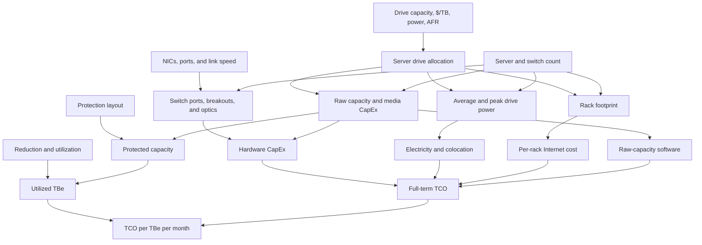

# Storage TCO model overview

This document describes the calculation model behind Storage TCO Lab. Its purpose is to make every major output traceable to a user-controlled assumption.

## Model scope

The model estimates the acquisition and full-term operating cost of a scale-out storage cluster. It connects seven groups of assumptions:

1. Drive profiles
2. Server design
3. Cluster and network fabric
4. Software and licensing
5. Workload, protection, and data reduction
6. Operating expense
7. TCO summary and normalized unit economics

The primary physical capacity unit is decimal terabytes (`TB`). Effective capacity is displayed as `TBe` after protection, data reduction, and utilization are applied.

## Dependency map



## Notation

| Symbol | Meaning                                          |
| ------ | ------------------------------------------------ |
| `S`    | Server count                                     |
| `Dᵢ`   | Count of drive profile `i` per server            |
| `Cᵢ`   | Raw capacity of drive profile `i` in TB          |
| `Kᵢ`   | Acquisition cost of drive profile `i` per raw TB |
| `d`    | Data shards or copies that hold unique data      |
| `p`    | Parity shards or redundant copies                |
| `U`    | Capacity-utilization fraction                    |
| `R`    | Data-reduction ratio                             |
| `Y`    | Deployment term in years                         |
| `M`    | Deployment term in months, `12 × Y`              |
| `PUE`  | Power usage effectiveness                        |

## Capacity model

### Raw capacity

Raw installed capacity is the capacity physically present in the cluster:

```text
Raw TB = S × Σ(Dᵢ × Cᵢ)
```

The model treats drive price per TB as a raw acquisition cost:

```text
Drive CapEx = S × Σ(Dᵢ × Cᵢ × Kᵢ)
```

### Protection overhead

For a layout containing `d` data shards and `p` parity shards:

```text
Protection factor = (d + p) / d
Protected TB = raw TB / protection factor
```

The available modes are:

| Mode         | Layout rule                  | Protection factor |
| ------------ | ---------------------------- | ----------------- |
| Mirror       | Fixed 1 data + 1 copy        | 2.0×              |
| RAID 5       | Configurable data + 1 parity | `(d + 1) / d`     |
| RAID 6       | Configurable data + 2 parity | `(d + 2) / d`     |
| Erasure code | Configurable data + parity   | `(d + p) / d`     |

### Data reduction and utilization

Data reduction is applied after protection. Utilization is the fraction of post-reduction effective capacity that the deployment is intended to fill:

```text
Data-reduced TBe = protected TB × R
Utilized TBe = data-reduced TBe × U
```

Therefore:

```text
Utilized TBe = raw TB / protection factor × R × U
```

The application uses utilized TBe as the effective-capacity denominator for unit economics. A higher data-reduction ratio raises effective capacity; a lower utilization target reserves more headroom and lowers utilized capacity.

## Server and network model

### Host connectivity

```text
Host ports per server = NIC count × ports per NIC
Total host ports = host ports per server × S
Host bandwidth per server = host ports per server × NIC speed
```

NIC speed can be 100G, 200G, 400G, or 800G.

### 800G switch breakout

The reference fabric uses 64-port 800G switches. A switch port can serve multiple lower-speed host ports:

```text
Breakout factor = floor(800 / NIC speed in Gb/s)
```

Examples are 8:1 for 100G, 4:1 for 200G, 2:1 for 400G, and 1:1 for 800G. Used switch ports are rounded separately across the configured switches, so host connections are not incorrectly combined across physical switch boundaries.

```text
Minimum switch count = ceil(total host ports / (64 × breakout factor))
```

The interface surfaces capacity and utilization for the configured fabric.

### Optics and switching CapEx

One host optic is counted for each physical host port. One switch-side optic is counted for each used 800G switch port after breakout.

```text
Switch hardware = switch count × 64 × average cost per switch port
Host optics = total host ports × host optic unit cost
Switch optics = used switch ports × switch optic unit cost
Network CapEx = switch hardware + host optics + switch optics
```

The Rev 1 reference uses $50,000 for a 64-port 800G switch, represented as $781.25 per port.

## Rack footprint

```text
Total RU = S × server RU + switch count × switch RU
Rack count = max(1, ceil(total RU / rack capacity RU))
```

Internet bandwidth is configured per rack, so adding enough equipment to cross a rack boundary increases network OpEx by one full rack allocation.

## Power model

### Drive power

For each drive profile, average power blends active and idle power using the workload duty cycle:

```text
Average drive watts = active watts × duty cycle
                    + idle watts × (1 − duty cycle)
```

Average drive power per server sums that result across all installed drives. Peak drive power assumes every drive is active.

### Cluster IT power

```text
Average IT watts = S × (server base watts
                        + average drive watts per server
                        + network overhead watts per server)
                   + switch count × switch watts

Peak IT watts = S × (server base watts
                     + peak drive watts per server
                     + network overhead watts per server)
                + switch count × switch watts
```

Peak IT power is the provisioned maximum used for colocation pricing. Average IT power is the metered workload basis used for energy:

```text
Provisioned kW = peak IT watts / 1,000
Annual facility kWh = average IT kW × 8,760 × PUE
```

## Hardware CapEx

```text
Server CapEx = S × server chassis cost
Hardware CapEx = drive CapEx + server CapEx + network CapEx
```

The server chassis cost is separate from raw media cost, preventing double counting and making mixed-drive configurations possible.

## Software model

Capacity-based software is always charged on installed raw TB, not effective TBe:

```text
Upfront software = raw TB × upfront $/raw TB
                 + S × upfront $/server

Recurring software = (physical cores × monthly $/core
                      + raw TB × monthly $/raw TB)
                     × M

Software total = upfront software + recurring software
```

Physical cores are server count × sockets × cores per socket. The reference scenario uses a recurring $3 per raw TB per month and zeroes for the other license dimensions.

## Operating-expense model

### Electricity

```text
Electricity = annual facility kWh × $/kWh × Y
```

Because annual facility kWh already includes PUE, the electricity cost includes the modeled facility overhead.

### Colocation

```text
Monthly colocation = provisioned peak kW × $/kW/month
Term colocation = monthly colocation × M
```

Colocation is based on provisioned maximum power, not average draw and not rack count.

### Internet bandwidth

```text
Term Internet cost = Gb/s per rack × rack count × $/Gb/s/month × M
```

The bandwidth input is deliberately per rack rather than per server.

### Drive replacement

Expected replacements use each drive profile’s annual failure rate:

```text
Replacement cost = Σ(total drivesᵢ × AFRᵢ × Y
                     × (drive unit costᵢ + replacement labor))
```

This is an expected-value calculation. It does not schedule replacements or model spare inventory.

### Support and administration

```text
Hardware support = hardware CapEx × annual support percentage × Y
Administration = annual administration cost × Y
```

```text
Operating expense = electricity
                  + colocation
                  + Internet bandwidth
                  + drive replacement
                  + hardware support
                  + administration
```

## Total cost of ownership

```text
TCO = hardware CapEx + software total + operating expense
```

The primary normalized result is:

```text
TCO per TBe per month = TCO / utilized TBe / M
```

The summary also reports the corresponding hardware, software, and operating contributions per TBe per month, along with total TCO per raw TB and per utilized TBe.

### Full-term cost categories

| Summary category     | Included costs                                                   |
| -------------------- | ---------------------------------------------------------------- |
| Hardware             | Drives, server chassis, switches, host optics, and switch optics |
| Energy               | PUE-adjusted electricity                                         |
| Colocation           | Peak-power colocation commitment                                 |
| Internet bandwidth   | Per-rack Internet service                                        |
| Software             | Upfront and recurring licenses                                   |
| Support & operations | Drive replacement, annual hardware support, and administration   |

The annual ledger records hardware and upfront software in the acquisition period. Recurring software and operating expense are spread evenly across the configured term for visualization.

## Durability model

The durability estimate evaluates one protection set using a binomial rebuild-window model.

For annual shard failure rate `AFR` and rebuild window in days:

```text
Rebuild periods per year = 365 / rebuild-window days
Failure probability per shard per period = 1 − exp(−AFR / periods per year)
```

If a layout has `n = d + p` total shards, loss begins at `p + 1` failures. The loss probability for one rebuild period is the binomial tail:

```text
Period loss probability = Σ C(n, k) × qᵏ × (1 − q)ⁿ⁻ᵏ
                          for k = p + 1 through n
```

That probability is converted to an annual loss probability over all rebuild periods:

```text
Annual loss probability = 1 − (1 − period loss probability)^(periods per year)
Annual durability = 1 − annual loss probability
```

The interface presents annual durability, durability nines, approximate annual odds, and the number of failures needed to lose the protection set.

### Durability assumptions

- Shard failures are statistically independent.
- AFR is constant and is distributed across rebuild windows.
- Rebuild time is deterministic.
- Every shard in the protection set has the weighted average AFR of the installed server drive mix.
- The estimate is for a single protection set, not the probability of at least one loss across an entire fleet.
- Correlated failures, rack and chassis failure domains, latent sector errors, firmware defects, human error, and rebuild-performance effects are outside the current scope.

The estimate is useful for comparing protection layouts under the same assumptions. It is not a durability guarantee.

## Rev 1 defaults

The defaults are defined in `apps/web/src/lib/tco-model.ts`. Highlights include:

- Five-year deployment term
- 12 storage servers
- 24 × 15.36 TB NVMe drives per server
- $350 per raw TB media cost
- RAID 6 with an 8+2 layout
- 90% utilization and 1.5× data reduction
- 2 dual-port 200G NICs per server
- 2 × 64-port 800G switches at $50,000 each
- 2,500 W and 2 RU per switch
- $3 per raw TB per month software subscription
- $135 per provisioned peak kW per month colocation
- 100 Gb/s Internet per rack at $100/Gb/s/month
- 3% annual hardware support

Use **Reset model** in the application to return to this baseline.

## Persistence and export

The application stores the current model as versioned JSON in browser local storage. This supports quick local iteration but is not a shared scenario repository. The summary’s CSV export captures the current cost ledger; it does not include every input assumption.

For a durable scenario record, export the ledger and separately record the input values or preserve the model JSON through a future scenario export feature.

## Known boundaries

The current implementation does not include:

- Taxes, financing, discount rate, net present value, or residual value
- Capacity growth and phased purchasing
- Vendor discount schedules or volume tiers
- Installation, migration, decommissioning, or disposal cost
- Downtime, SLA penalties, or business impact
- Detailed cooling, UPS, or generator modeling beyond PUE
- Oversubscription, fabric topology, switch redundancy policy, or cable cost beyond the reference optic model
- Separate labor tiers, benefits, or staffing growth
- Correlated durability events or fleet-level loss probability

These boundaries are intentional so the Rev 1 model remains understandable and easy to audit.

## Implementation references

| Concern                                           | Source                                    |
| ------------------------------------------------- | ----------------------------------------- |
| Defaults, capacity, cost, power, network, and TCO | `apps/web/src/lib/tco-model.ts`           |
| Protection layouts and durability                 | `apps/web/src/lib/durability.ts`          |
| Model configuration interface                     | `apps/web/src/components/model-pages.tsx` |
| Persistence, reset, navigation, and CSV export    | `apps/web/src/App.tsx`                    |
| Shared shadcn components and SNIA theme tokens    | `packages/ui/src`                         |
